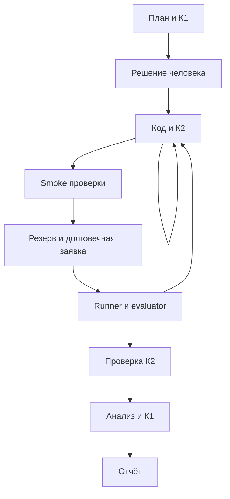

# Архитектура

## Роли

| Роль | Результат | Полномочия |
|---|---|---|
| Исследователь | ExperimentSpec и ResearchConclusion | Предлагает одну проверяемую модификацию, интерпретирует измерения |
| Разработчик | CodeProposal, Git commit, diff | Меняет только файлы из профиля, не получает доступ к evaluator |
| К2 | ReviewDecision | Проверяет реальные исходники и RunRecord; решение связано с digest |
| Исполнитель | RunRecord и артефакты | Запускает точный RunSpec и защищённую оценку; не меняет настройки |
| К1 | ReviewDecision | Проверяет план и вывод; не может увеличить бюджет |

LLM роли вызываются только в соответствующих состояниях. Исполнитель — программный runner. Провайдер использует совместимый с Chat Completions JSON интерфейс; промпты и модели конфигурируются в `agents.py` и окружении. Источники, код и логи передаются как недоверенные данные. JSON ответы валидируются; максимум две попытки исправления формата.

## Состояние и восстановление

Один вызов графа выполняет один шаг. Полный snapshot сохраняется SQL транзакцией после шага, а lease и резерв LLM — **до внешнего вызова**. Здесь используется собственная SQL граница checkpoint, а не параллельное сохранение того же состояния в LangGraph checkpointer. Это исключает две конкурирующие версии истины.

MVP предполагает один worker. Строка `locks` сериализует короткие транзакции; внешний I/O выполняется вне транзакции. Lease действителен 300 секунд; LLM запросы ограничены 60 секундами каждый и тремя попытками. Человеческое решение во время I/O не перезаписывается завершившимся worker.

Перед SSH submit сохраняется RunSpec и резерв максимального GPU времени. Контейнер получает имя из idempotency_key. Runner под flock сначала сохраняет intent, затем создаёт контейнер. После сбоя inspect находит уже созданную задачу. Удаление контейнера до завершения reconciliation означает ошибку инфраструктуры, а не разрешение создать дубликат.

Отмена до submit записывает tombstone. Поздний submit возвращает CANCELLED. При потере SSH остаётся CANCEL_PENDING; подтверждать остановку без связи нельзя. Таймаут выполняется внутри контейнера через `timeout`, независимо от control plane.

## Бюджеты

LLM резерв на один шаг покрывает три запроса с консервативным потолком входных токенов и max_tokens. Резерв не освобождается после неоднозначного сбоя и не выдаётся за фактический биллинг. Фактический usage сохраняется отдельно. Цены задаёт оператор; неверный тариф невозможно исправить по ответу LLM.

GPU резерв равен walltime × число GPU; быстрый запуск не возвращает резерв автоматически. Это консервативное ограничение общего числа/длительности назначений. Smoke тоже учитывается. Демо не использует GPU.

## Данные и оценка

Текущий adapter поддерживает бинарную классификацию JSON. Модель видит train labels и validation features. Метки validation помещаются только в контейнер evaluator. Evaluator не импортирует модель, не загружает pickle и проверяет количество, идентификаторы, допустимость и конечность предсказаний. Digest включает код evaluator и его labels.

Статистика — парные метрики по заранее заданным seed. Правило supported требует положительного прироста не меньше практического delta во всех парах. Это заранее объявленное описательное правило пилота, не статистический тест и не гарантия воспроизводимости вне данных. При смешанном результате вывод inconclusive.

Артефакты runner хранятся в отдельном каталоге запуска. MLflow содержит параметры, метрики и URI каталога; полные файлы не дублируются в MLflow автоматически. Git хранит отдельные локальные evidence снимки, не изменяет основную ветку исследуемого проекта.

## Ограничения

- Один активный проект, один worker и одна последовательная очередь GPU.
- План меняет человек через request_changes; произвольный автономный перебор научных направлений не включён.
- Источники задаются пользователем; встроенного web search/чтения PDF нет. URL сам по себе не считается прочитанной статьёй.
- Локальная аутентификация одним токеном, без multi-tenant RBAC.
- Профили и доверенные образы настраивает оператор. Генерировать их силами исследовательских агентов запрещено.
